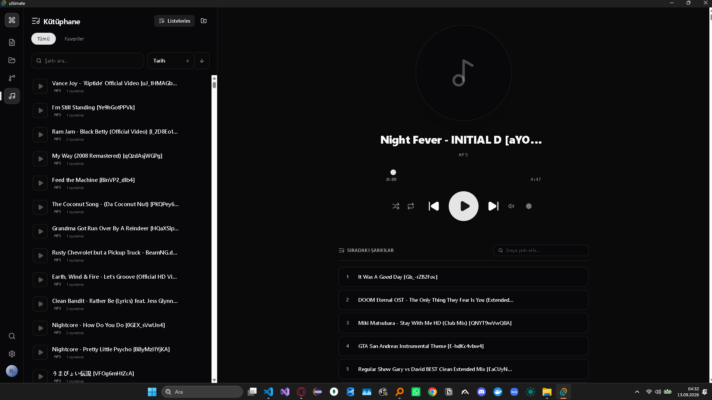
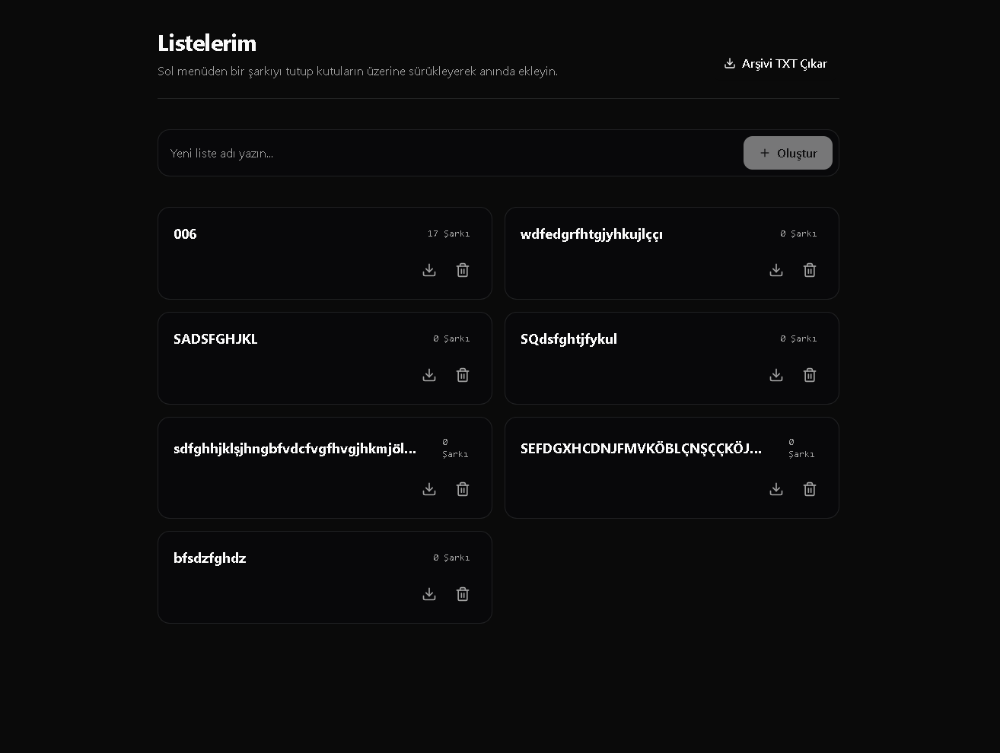
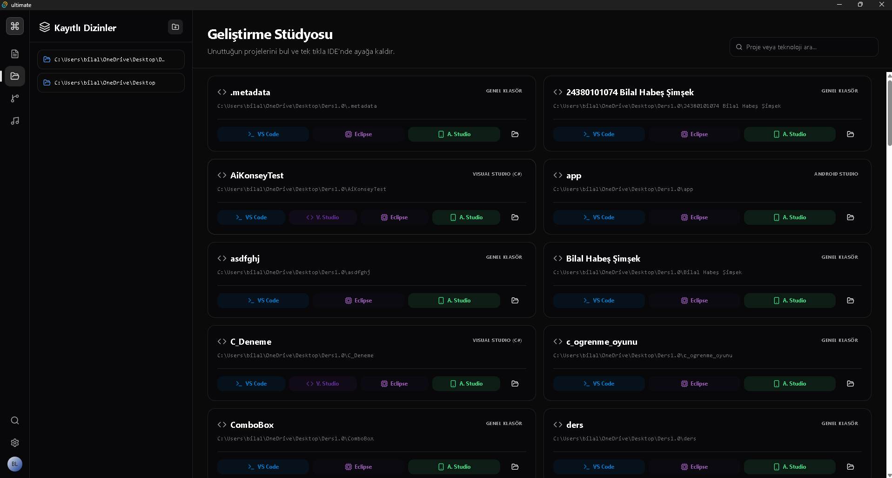
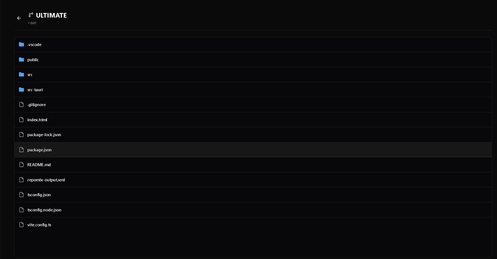
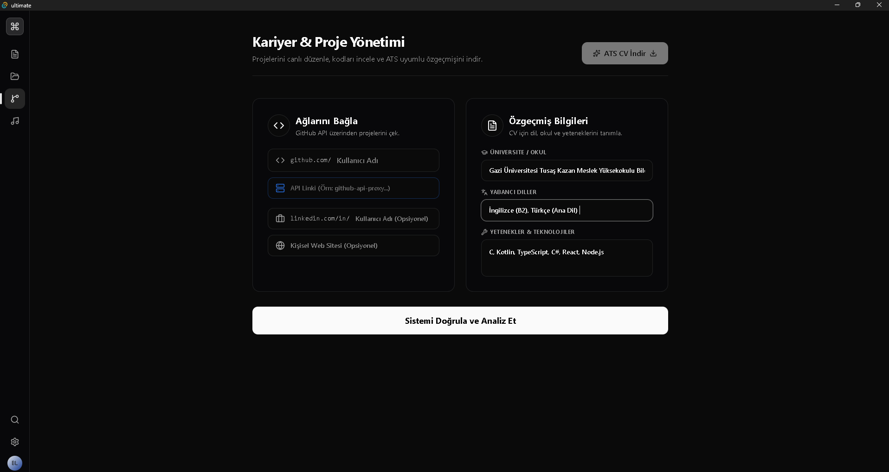
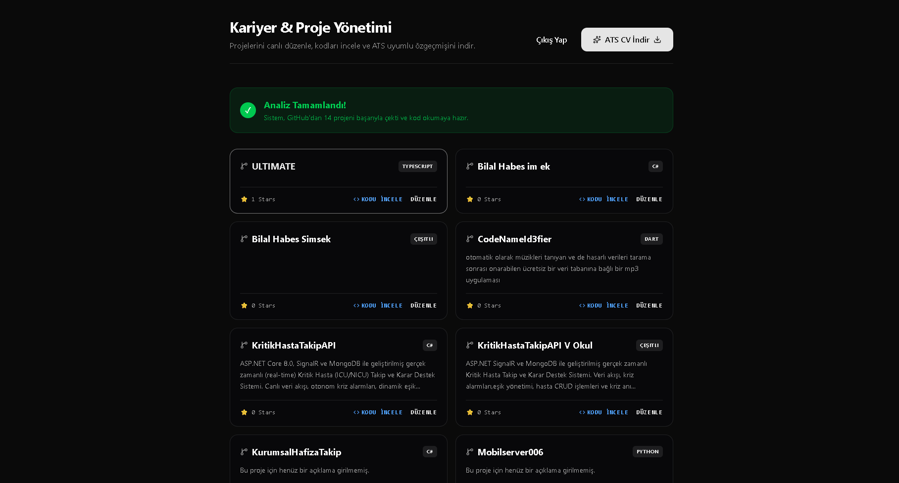
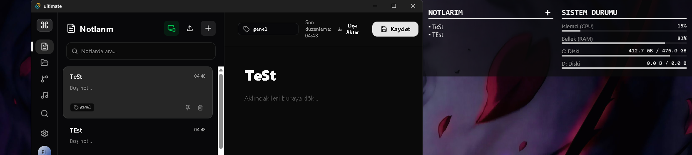

# 🚀 ULTIMATE - Geliştirici Asistanı & Medya İstasyonu


**ULTIMATE**, geliştiricilerin günlük iş akışlarını hızlandırmak ve multimedya ihtiyaçlarını tek bir merkezden yönetmek için tasarlanmış, **Tauri ve Rust** tabanlı yüksek performanslı bir masaüstü (Desktop) uygulamasıdır[cite: 3]. 

Sistem kaynaklarını minimum düzeyde tüketirken; akıllı müzik çalar, proje başlatıcı stüdyo, GitHub destekli ATS CV oluşturucu ve Rainmeter entegreli not defteri modüllerini modern bir arayüzde sunar[cite: 3].

---

## ✨ Temel Modüller ve Özellikler

### 🎵 1. Akıllı Medya Oynatıcı (Player)
* **Kapsamlı Format Desteği:** Klasik ses formatlarının (MP3, WAV, FLAC vb.) yanı sıra `@tonejs/midi` altyapısı sayesinde yerel **MIDI (.mid)** dosyalarını çok sesli sentezleyici (PolySynth) ile çalar[cite: 3].
* **Gelişmiş Kuyruk Yönetimi:** Şarkıları sıraya alma, yukarı/aşağı taşıma, sıranın en üstüne sabitleme (Pin) ve özel listeler (Playlist) oluşturma[cite: 3].
* **Sürükle-Bırak:** Yerel klasörleri tarayıp arşivi oluşturduktan sonra şarkıları sürükleyerek çalma listelerine ekleme[cite: 3].

| Müzik Çalar & Kuyruk Yönetimi | Özel Çalma Listeleri |
| :---: | :---: |
|  |  |
| *MIDI destekli, gelişmiş kuyruk ve oynatma yönetimi sunan entegre müzik çalar.* | *Sürükle-bırak destekli sınırsız oynatma listesi (playlist) ve arşiv txt/dışa aktarım yönetimi.* |

---

### 💻 2. Geliştirme Stüdyosu (Projects)
* **Otomatik Keşif:** Belirlenen ana dizinlerdeki projeleri tarar ve içindeki dosyalara (`package.json`, `pom.xml`, `CMakeLists.txt`, `.sln`) bakarak projenin teknolojisini (React, Java, C++, C#, Python, Android) otomatik tespit eder[cite: 3].
* **Tek Tıkla IDE Başlatma:** Projeleri doğrudan bulundukları dizin üzerinden işletim sistemi komutlarıyla **VS Code, Visual Studio, Eclipse veya Android Studio**'da anında ayağa kaldırır[cite: 3].

| IDE Başlatıcı & Kayıtlı Dizinler | Repo Dosya İnceleyici |
| :---: | :---: |
|  |  |
| *Yerel projeleri otomatik tanıyıp VS Code, Visual Studio ve Android Studio gibi IDE'lerde başlatma ekranı.* | *GitHub depolarını uygulama içinden klasör/dosya ağacıyla anlık olarak inceleme.* |

---

### 📄 3. Kariyer & GitHub Yöneticisi
* **GitHub Entegrasyonu:** Kullanıcı adı ile açık kaynaklı depoları çeker, yıldız sayısına göre sıralar ve depo içeriklerini (kodları) uygulama içinden canlı okutur[cite: 3].
* **ATS Uyumlu CV Üretici:** GitHub verilerini, girilen eğitim ve yetenek setlerini harmanlayarak ATS okuyucularından %100 geçecek saf bir CV oluşturur[cite: 3]. Bu CV, **Markdown (.md) veya TXT** formatlarında dışa aktarılabilir[cite: 3].

| Özgeçmiş & GitHub Bağlantısı | Depo (Repo) Analizi |
| :---: | :---: |
|  |  |
| *ATS uyumlu Markdown/TXT özgeçmiş oluşturmak için okul, dil ve yetenek giriş paneli.* | *Kullanıcının GitHub depolarının canlı analizi ve yıldız sayılarına göre sıralı listesi.* |

---

### 📝 4. Rainmeter Uyumlu Not Defteri
* **Anlık Senkronizasyon:** Alınan notları (Ctrl+S) anında belirtilen bir yerel `.txt` dosyasına yazar[cite: 3]. Bu sayede masaüstündeki **Rainmeter** widget'ları notları anlık olarak ekranda gösterebilir[cite: 3].
* Hızlı etiketleme, sabitleme (Pin), içe/dışa dosya aktarımı ve anlık arama özellikleri[cite: 3].

| Rainmeter Widget & Not Senkronizasyonu |
| :---: |
|  |
| *Uygulama üzerinden alınan notların (Ctrl+S) anlık olarak masaüstündeki özel Rainmeter widget'ına aktarılması.* |

---

### ☁️ 5. Bulut Senkronu (Supabase)
* **Hesaba Bağlı Güvenlik:** Giriş e-posta + şifre ile yapılır; tüm tablolar **RLS** ile korunur (`auth.uid() = user_id`). Uygulamanın içindeki publishable key'i ele geçiren biri, senin hesabına giriş yapmadıkça verilerine erişemez.
* **Anlık Yedekleme:** Notlar `Ctrl+S` ile hem yerel dosyaya hem **Supabase** `notes` tablosuna yazılır.
* **Takvim Senkronu:** Takvim etkinlikleri `calendar_events` tablosunda tutulur; uygulama ilk açılışta yereldeki (`localStorage`) eski etkinlikleri otomatik olarak buluta taşır.
* **Müzik Senkronu:** Çalma listeleri (`playlists`), favoriler ve dinleme sayıları (`music_state`) bulutta tutulur; başka bir cihazda aynı liste ve favoriler hazır gelir.
* **Kararlı Şarkı Kimlikleri:** Şarkıların kimliği taranan kök klasöre göre göreli yoldur (ör. `rock/parca.mp3`). Böylece müzik klasörü yeniden tarandığında favori ve listeler **yanlış şarkıya işaret etmez**; klasör hatırlanır ve açılışta otomatik taranır.
* **Realtime:** Aynı hesaptan açılan diğer pencereler/cihazlar, veritabanı olaylarını (**INSERT/UPDATE/DELETE**) kanal üzerinden dinleyerek listeleri anında günceller.
* **Offline-first:** Bağlantı yoksa uygulama `localStorage`'a düşer; takvim başlığında küçük bir "yerel" rozeti görünür ve kullanım kesintisiz devam eder.
* **Şema:** Tüm tablolar, RLS politikaları ve realtime ayarları `supabase/schema.sql` dosyasındadır.

---

## 🛠️ Kullanılan Teknolojiler

* **Backend & Çekirdek:** Rust, Tauri 2.0 API, Native OS Commands (`std::process::Command`)[cite: 3]
* **Frontend:** React 19, TypeScript, Vite[cite: 3]
* **Stil & UI:** Tailwind CSS v4, Lucide React Icons[cite: 3]
* **Ses Motoru:** Web Audio API, Tone.js[cite: 3]

---

## 🚀 Kurulum ve Çalıştırma

Projeyi kendi bilgisayarınızda çalıştırmak veya derlemek için Node.js ve Rust (Cargo) ortamlarının kurulu olması gerekmektedir[cite: 3].

1. Depoyu klonlayın:
   ```bash
   git clone https://github.com/bilalhabessimsek/ULTIMATE.git
   cd ULTIMATE
   ```

2. Bağımlılıkları yükleyin:
   ```bash
   npm install
   ```

3. Ortam değişkenlerini ayarlayın:
   ```bash
   cp .env.example .env
   ```
   `.env` içine Supabase **Project URL** ve **Publishable key**'ini girin (aşağıya bakın).

4. Geliştirme modunda çalıştırın:
   ```bash
   npm run tauri dev
   ```

5. Üretim derlemesi (Windows `.msi` / `.exe` dahil):
   ```bash
   npm run tauri build
   ```

---

## ☁️ Supabase Kurulumu (Bulut Senkronu)

Notların bulutta senkronize olması için tek seferlik kurulum gerekir:

1. [supabase.com/dashboard](https://supabase.com/dashboard) adresinden projenizi açın.
2. Proje ana sayfasındaki **`Connect`** butonuna tıklayın → **Project URL** ve **Publishable key**'i kopyalayın.
3. Kopyaladıklarınızı `.env` dosyasına yazın:
   ```env
   VITE_SUPABASE_URL=https://<20-haneli-proje-ref>.supabase.co
   VITE_SUPABASE_ANON_KEY=sb_publishable_...
   ```
   > ⚠️ **Project URL'deki ref'i birebir kopyalayın.** Tek bir harf hatası (ör. `g` ↔ `q`) DNS kaydını tamamen kırar ve hata "DNS adı yok" olarak görünür.

4. **Tablolar + politikalar + realtime:** `supabase/schema.sql` dosyasının **tamamını** SQL editöründe çalıştırın. Script;
   - `notes`, `calendar_events`, `playlists`, `music_state` tablolarını,
   - **hesaba bağlı** RLS politikalarını (`auth.uid() = user_id`),
   - realtime yayın üyeliğini
   
   tek seferde kurar. Ayrıca 7. bölümü sahipsiz eski satırları ilk kullanıcıya bağlar ve bileşik anahtarları (`user_id + name/key`) oluşturur.

   > ⚠️ Önce **Authentication → Users** ekranından bir kullanıcı oluşturun. Kullanıcı yoksa script uyarı verip durur (bilinçli koruma).
   > ⚠️ Elle **`using (true)` politikası eklemeyin.** Postgres politikaları varsayılan olarak **VEYA** ile birleşir; tek bir gevşek politika tüm RLS korumasını geçersiz kılar.

**Hızlı doğrulama (terminal):**
```bash
curl -s -H "apikey: $VITE_SUPABASE_ANON_KEY" \
  "https://<proje-ref>.supabase.co/rest/v1/notes?select=id&limit=1"
```
Oturum açılmadığı için `[]` dönmesi **beklenen** davranıştır (RLS veriyi kapatıyor). Yazma denemesi `42501` ile reddedilmeli.

---

## 🔐 Kimlik Doğrulama (Auth)

Notlar, takvim ve listeler artık **hesaba bağlı**. Satır Düzeyi Güvenlik (RLS) politikaları `auth.uid() = user_id` şeklinde olduğu için publishable key'e sahip başka biri **kendi hesabı olmadan verilerini göremez**.

Kurulum sırası önemli:

1. Dashboard → **Authentication → Users** → *Add user* → e-posta + şifre gir, **Auto Confirm** işaretli olsun.
2. `supabase/schema.sql` dosyasının tamamını SQL editöründe çalıştır (7. bölüm sahipsiz eski satırları otomatik olarak bu kullanıcıya bağlar).
3. Uygulamayı aç → giriş ekranı gelir → aynı e-posta/şifre ile giriş yap.

> E-posta onayı zorunlu olsun istemiyorsan: Authentication → Sign In / Providers → Email → **Confirm email** kapalı olabilir. Kapalıysa hesap oluşturur oluşturmaz giriş yapılır.

Oturum yerelde saklandığı için uygulama her açılışta tekrar giriş istemez; çıkış için sol menüdeki **çıkış (LogOut)** butonu kullanılır.

### 🔁 Şifre Sıfırlama (6 haneli kod)

Masaüstü uygulamasında e-posta bağlantısı (magic link) özel URL şeması kaydı gerektirdiği için kırılgandır. Bu yüzden **kod (OTP)** yöntemi kullanılır:

1. Giriş ekranı → **Şifremi unuttum** → e-postanı gir → *Sıfırlama Kodu Gönder*.
2. Supabase e-posta gönderir. **Şablonun içinde kodu göstermen gerekir** (aşağıdaki adım).
3. Uygulamaya 6 haneli kodu + yeni şifreyi gir → *Şifreyi Güncelle*.

**Zorunlu tek ayar:** Dashboard → **Authentication → Email Templates → Reset Password** şablonunu aç ve şu satırı ekle (varsa linki silebilirsin):

```html
<h2>Şifre Sıfırlama</h2>
<p>ULTIMATE hesabın için sıfırlama kodun:</p>
<p style="font-size:28px;font-weight:bold;letter-spacing:6px">{{ .Token }}</p>
<p>Bu kod 1 saat geçerlidir. Kodu uygulamadaki "Şifremi Unuttum" ekranına gir.</p>
```

> `{{ .Token }}` 6 haneli kodu basar. Şablonda bu değişken yoksa kullanıcı yalnızca link görür ve uygulamaya girecek kod bulamaz.
> Kodun geçerlilik süresi: Authentication → Providers → Email → *Email OTP Expiry* (varsayılan 3600 sn).
> Çok fazla kod istemek Supabase'in e-posta limitine takılır; kendi SMTP sunucunu (ör. Resend) bağlarsan limit kalkar.

